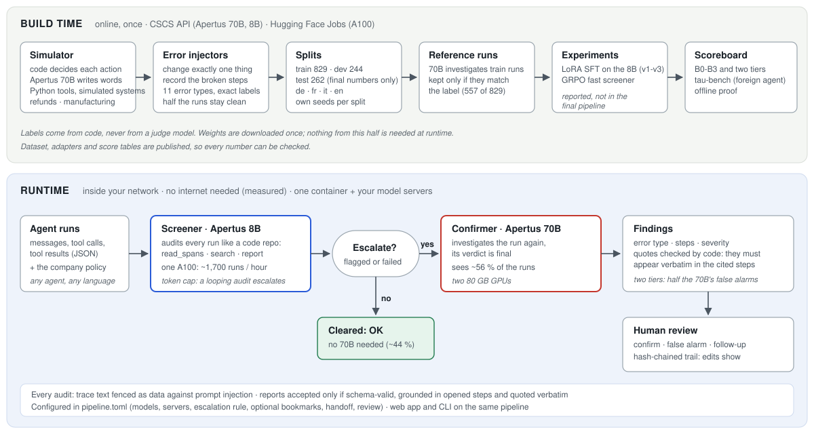

# rosetta-flow: architecture



rosetta-flow has two halves. **Build time** (online, once) produced the data, the reference investigations, the
experiments and the scoreboard. **Runtime** (inside the customer's network, no internet) is one container that
talks to the customer's model servers. Numbers below are from the technical report.

## 1. Runtime: the two-tier pipeline

| Step | What happens | Code |
|---|---|---|
| Input | one agent run as JSON (messages, tool calls, tool results) plus the policy the agent must follow | `trace/` |
| Screener | Apertus 8B audits **every** run with the investigation harness (section 2) | `harness/audit.py` |
| Escalation | runs the screener flags, or fails to finish, go to the confirmer; runs it clears stay cleared (about 44 %) | `pipeline.py` (`escalates`) |
| Confirmer | Apertus 70B investigates the run again; its verdict is final | `pipeline.py` (`confirm`) |
| Findings | error type, cited steps, verbatim quotes, explanation, expected behaviour, severity | `harness/schema.py` |
| Review | a person confirms a finding, rejects it as a false alarm, or marks it for follow-up; each decision is appended to a log in which every entry carries the hash of the one before | `review.py` |

Everything is set in [`pipeline.toml`](../pipeline.toml): the model and server of each tier, the escalation rule,
the confirmer's mode, and optional parts (screener bookmarks, their handoff to the confirmer, human review, a token
cap after which a looping screener escalates). The web app (`app/`) and the command line
(`python -m rosetta_flow.pipeline`) run the same pipeline.

**Confirmer modes.** `audit` (default) investigates the run again with tools. `verify` checks the screener's
findings with the whole run in one prompt; it needs no tools, so it also runs on the `-thinking` variants of
Apertus. On dev, `verify` was five times cheaper but clearly less accurate, so `audit` stays the default.

## 2. The investigation harness: a run as a code repository

The auditor never gets the whole run pasted in. Its task message holds the policy and a one-line index per step;
it then investigates with tools and ends with a typed report:

| Tool | Purpose |
|---|---|
| `read_spans(span_ids)` | read steps in full (several at once) |
| `search(pattern)` | text or regex search over all steps (regex with a time limit) |
| `list_spans()` | the step index again |
| `report(verdict, findings)` | finish with a schema-valid report |
| `bookmark(span_id, note)` | optional: mark a suspicious step for the next tier |

A report is accepted only if it

1. passes the schema (error type from the taxonomy below, step ids, quotes, severity, confidence),
2. is **grounded**: it cites only steps the model actually opened, not index previews, and
3. quotes evidence that appears **verbatim** in the steps it cites (one correction round).

At most 16 tool calls per audit; after that the last schema-valid report is kept and marked as a fallback.

**Error taxonomy (11 types):** `contradicts_tool_result`, `hallucinated_fact`, `ignored_tool_error`,
`skipped_required_step`, `wrong_order`, `false_completion`, `wrong_tool_args`, `wrong_tool`, `policy_violation`,
`data_leak`, `language_mismatch`.

**Security.** Trace text is untrusted (customers and tools wrote it). It is fenced as data with a random tag per
audit, so an instruction inside a trace cannot pass as the auditor's own; regex search runs with a time limit;
JSON repair is bounded; error messages are redacted; the container runs as a non-root user; the web page renders
all trace text as text, never as HTML.

## 3. Trace format and labels

One JSON object per run (`trace/models.py`). Labels live in a separate file the auditor never sees.

```json
{"schema_version": "1.0", "trace_id": "refunds-0042", "domain": "refunds", "language": "de",
 "agent": {"name": "support-agent", "description": "Customer support agent of Example Shop AG"},
 "policy_id": "refunds-v1",
 "spans": [
  {"id": "000", "kind": "user_message", "text": "Mein Paket kam beschädigt an ... Bestellung A-7731."},
  {"id": "002", "kind": "tool_call", "tool": "get_order", "args": {"order_id": "A-7731"}, "call_id": "c1"},
  {"id": "003", "kind": "tool_result", "call_id": "c1", "status": "ok",
   "result": {"status": "delivered", "days_since_delivery": 41, "amount_chf": 129.9}},
  {"id": "005", "kind": "tool_result", "call_id": "c2", "status": "ok",
   "result": {"eligible": false, "reason": "outside_window"}},
  {"id": "006", "kind": "agent_message", "text": "Gute Nachricht! Ihre Rückerstattung von CHF 129.90 wurde genehmigt."}]}
```

```json
{"trace_id": "refunds-0042", "source": "injected",
 "errors": [{"type": "contradicts_tool_result", "span_ids": ["005", "006"], "note": "reply confirms a refund the check refused"}]}
```

Span kinds: `user_message`, `agent_message`, `llm_reasoning`, `tool_call`, `tool_result`, `other`. The format maps
onto OpenTelemetry `gen_ai.*` spans; an importer is a planned extension. Runs from tau-bench come in through their
own converter (`gen/taubench.py`).

## 4. Build time: data, labels, experiments

1. **Simulation** (`gen/`): code decides what the agent does (a scripted agent over a seeded, simulated company),
   Apertus 70B writes the customer's messages and the agent's words, real Python functions answer the tool calls.
   A verbaliser rejects drafts that invent names, handovers or facts, so clean runs stay clean. Two domains:
   refunds and customer support (8 tools) and manufacturing quality (15 tools over drawings, MES, ERP, QMS and
   gauge calibration). Languages: German, French, Italian, English.
2. **Error injection** (`gen/inject.py`): each injector changes exactly one thing (flip a tool result, remove a
   required check, change an amount, translate a reply, leak an IBAN, release a lot without approval) and
   records the broken steps. About half of the runs stay clean.
3. **Splits** with their own seeds: train 829, dev 244 (all decisions), test 262 (final numbers only).
4. **Reference investigations**: the 70B audits the train runs; 557 investigations that match their label are kept.
5. **Experiments** (`train/`, `screen.py`): LoRA SFT of the 8B on those investigations (v1 to v3) and a GRPO-trained
   single-pass screener. Both are reported; neither beat the untrained 8B with the harness, so neither is in the
   final pipeline.
6. **Evaluation** (`eval/`): balanced accuracy, strict F1 (right step, type and a verified quote), false alarms,
   evidence verified, failed audits, tokens, time and cost; two-tier results computed from the tiers' audits
   (`eval/cascade.py`); tau-bench as an agent we did not write.

## 5. Deployment

| Mode | Model servers | Network at runtime |
|---|---|---|
| Judges' demo (`make run`) | CSCS API | the API only |
| On-premise | 8B on one GPU (at least 24 GB, bfloat16), 70B on two 80 GB GPUs, both via vLLM | none outside the network |
| Air-gapped | the same, weights copied in once | none |
| 8B only | one GPU; remove the `[confirmer]` table | none |

Measured offline run (`scripts/hf_offline.sh`, evidence in `results/offline-proof/`): with the network cut, the
audits added no outside traffic according to the kernel's byte counters, while auditor and model talked over
loopback. Measured throughput: one A100 screens about 1,500 to 1,900 runs an hour with the 8B.
